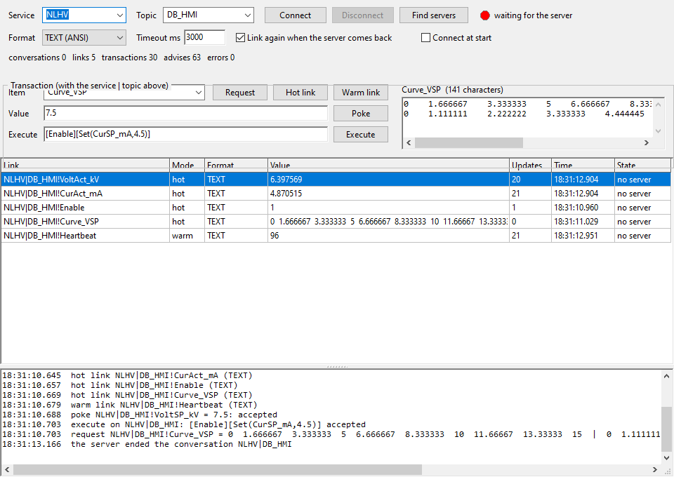

# DDE Client (Lazarus)

A general DDE client, written in Free Pascal / Lazarus with normal forms. It uses the Windows DDEML (`user32.dll`) and needs no other DLL. It works with the [DdeServer](../DdeServer/README.md) of this project, with Excel, and with every other DDE server. Windows Explorer still answers as `PROGMAN|PROGMAN`.



## Build and run

Open `DdeClient.lpi` in Lazarus and press Run, or:

```bash
C:\lazarus\lazbuild.exe DdeClient\DdeClient.lpi
```

The defaults (`NLHV`, `DB_HMI`, `VoltAct_kV`) connect to the DdeServer. Press **Connect** (`F5`), choose an item, then press **Hot link**.

## Window

- **Connection**:
  - **Service and topic:** **Find servers** (`F7`) lists every service|topic pair that answers on this PC, and fills the lists.
  - **Connect** opens the conversation. It reads the item list from `TopicItemList` (`SysItems` in `System`) and the topics from `System!Topics`, if the server has them. **Disconnect** (`F6`) ends all conversations.
  - **Format:** `TEXT` (ANSI code page) or `UNICODETEXT`.
  - **Timeout** of each transaction.
  - **Link again when the server comes back.**
  - **Connect at start.**
- **Transaction** (with the service and topic above):
  - **Request:** the value appears in the box on the right, tabs as columns and rows as lines.
  - **Hot link:** every change comes with its value. **Warm link:** the server announces a change, and the client then requests the value.
  - **Poke** (`Enter` in the value): `\t` = tab, `\n` = new row, so a curve is `0\t5\t10\n0\t3.3\t10`.
  - **Execute** (`Enter`), for example `[Enable][Set(VoltSP_kV,7.5)]`.
  - A refused poke or execute shows the server's reason from `System!ReturnMessage`, when the server has one (DdeServer and Excel do).
- **Links table:** link (`service|topic!item`), hot / warm, format, value, number of updates, time, state (active, no server, refused).
  - **Double-click** a link: its service, topic, item and value go to Poke.
  - Right-click: *Request now*, *Copy value*, *Remove link* (`Del`), *Remove all links*.
- **Log**: conversations, links, transactions with their results, and DDEML errors as text (for example "no conversation (server not running or topic unknown)").

The settings and links are saved in `DdeClient.ini` next to the exe. At the next start the links are made with **Connect**, or at once with *Connect at start*.

## When the server ends

The server ending the conversation sets the links to "no server".
- **The server starts again:** DDEML tells every client when a service registers, so the links are made again at once. Otherwise the client tries every 3 s.
- **Your own Disconnect** keeps the links but makes no new conversation until you press Connect.
- **A new link** gets the current value at once with a request, because a link only sends changes.

## Command line (for tests and scripts)

```
--service=NLHV --topic=DB_HMI --format=UNICODETEXT --find --connect
--link=VoltAct_kV,CurAct_mA  --warm=Heartbeat  --poke=VoltSP_kV=7.5
--exec=[Enable] --request=Curve_VSP
--dump=<file.txt> --after=<s>      the links table and the log to the file, then exit
--snapshot=<file.png>              the window as a PNG (with --after)
```

A run with `--dump` doesn't load or save the links of `DdeClient.ini`.

## Test that was run

- **Against DdeServer:**
  - 4 hot links and 1 warm link, a poke, an execute and a curve request: 131 advises in 4 s, no errors.
  - Three clients at once: one client's Unicode hot link to `Data!Msg` got `Grüße von C: 5 µA` from another client's poke.
- **Server killed and started again:** both clients showed "the server ended the conversation". 3 s later, when the new server registered, they logged "service NLHV registered" and made all their links again within 0.15 s. A poke after the restart reached the Unicode link.
- **Against Windows Explorer:**
  - **Find servers:** `PROGMAN|PROGMAN`, `Shell|AppProperties`, `Folders|AppProperties`.
  - **Request:** `PROGMAN|PROGMAN!PROGMAN` returned the Start menu groups.
- **Without a server:** the link shows "no server" and the log has the DDEML error as text.

## Files

```
DdeClient.lpi / .lpr         project
uclimain.pas / .lfm          main window (designer form)
uddecli.pas                  DDE client: conversations, request / poke / execute, links, reconnect
../DdeServer/uddeml.pas      DDEML API (32 / 64 bit) and helpers, shared with the server
../DdeServer/ufrmsnap.pas    --snapshot: the window as a PNG
```
