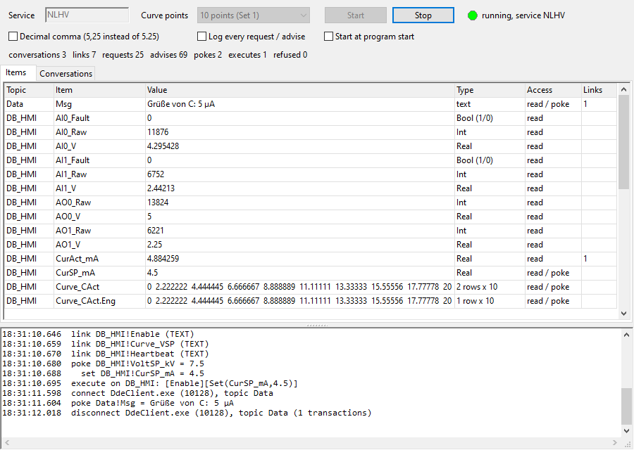

# DDE Server (Lazarus)

A DDE server with the simulated HV PLC, written in Free Pascal / Lazarus. It uses the Windows DDEML (`user32.dll`) and needs no other DLL. Excel, Word, LabVIEW, old SCADA programs, [DdeClient](../DdeClient/README.md) and any other DDE client can read and write the PLC tags:

```
=NLHV|DB_HMI!VoltAct_kV
```

The PLC logic and the nonlinear HV plant are the same as in [OpcUaSim](../OpcUaSim/README.md) and [MqttSim](../MqttSim/README.md): the unit `uplcsim.pas` is shared.



## Build and run

Open `DdeServer.lpi` in Lazarus and press Run, or:

```bash
C:\lazarus\lazbuild.exe DdeServer\DdeServer.lpi
```

1. Set the **Service** (default `NLHV`).
2. Choose **Curve points**: 10 = Set 1, or 2 = Set 2 with input protection.
3. Press **Start** (`F5`).

The settings are saved in `DdeServer.ini` next to the exe:
- *Decimal comma* sends `5,25` instead of `5.25`, for an Excel with German or other comma settings. Values written to the server can use either.
- *Start at program start*, or the option `--start`, starts the server at once.
- `AdviseMs=100` in the ini sets how often changed values are sent on links.

| Window part | |
|---|---|
| Status line | conversations, links, requests, advises sent, pokes, executes, refused |
| **Items** tab | every topic!item with its value, type, access (read / poke) and the number of links. Right-click → *Copy Excel formula* (`Ctrl+C`) gives `=NLHV\|DB_HMI!VoltAct_kV` |
| **Conversations** tab | the client program (exe and process id), topic, connect time, transactions, links |
| Log | connects, links, pokes, executes and every refusal with its reason; *Log every request / advise* shows all of them |

## Topics and items

| Topic | Items | Access |
|---|---|---|
| `DB_HMI` | `VoltSP_kV`, `CurSP_mA` | read / poke |
| | `VoltAct_kV`, `CurAct_mA`, `AO0_V`, `AO1_V`, `AI0_V`, `AI1_V`, `AO0_Raw` … `AI1_Raw`, `Heartbeat` | read |
| | `Enable` (`1` / `0`) | read / poke |
| | `Valid_VSP` / `VAct` / `CSP` / `CAct`, `AI0_Fault`, `AI1_Fault` | read |
| | `Curve_VSP` (also `VAct`, `CSP`, `CAct`): 2 rows, Eng and Volt, 10 or 2 values each | read / poke |
| | `Curve_VSP.Eng`, `Curve_VSP.Volt`, …: one row | read / poke |
| | `Err_VSP` … `Err_CAct` (Set 2, poke 0 = acknowledge), `VSP_Limited`, `CSP_Limited` | read / poke, read |
| `Sim` | `Counter` (+1 per 100 ms), `Sine`, `Toggle` (every 2 s), `Clock` (`2026-10-26 18:19:57.501`, local time) | read |
| `Data` | any name: a poke makes the item, other clients link to it (up to 1000 items) | read / poke |
| `System` | `Topics`, `SysItems`, `Formats`, `Status` (`Ready`), `Help`, `ReturnMessage` | read |

Every topic also has `TopicItemList` (its items) and `Formats`. Names are not case sensitive.

**Value format:**
- **Booleans:** `1` / `0`.
- **Numbers:** up to 7 digits (Float) or 10 digits (Double).
- **Curves:** values separated by tabs, rows separated by CR LF. Excel puts them into cells with an array formula `{=NLHV|DB_HMI!Curve_VSP}` over 2 × 10 cells.

**Writing (poke):**
- **Values:** numbers with `.` or `,`; booleans as `1 0 true false on off`.
- **Curves:** separated by tab, `;`, blanks or `,` (`,` only when *Decimal comma* is off).
- **Refusals:** a wrong value, a read-only item or the wrong number of curve values is refused (`DDE_FNOTPROCESSED`). The reason is logged and is in `System!ReturnMessage`.
- **PLC rules:** the next PLC cycle (50 ms) applies the same rules as the real PLC. In Set 2, a bad calibration sets `Err_xxx`, and the setpoints are clamped.

## Transactions

| | |
|---|---|
| Connect | the four topics; `DdeConnectList` / wildcard connects get every service\|topic pair |
| Request | `CF_TEXT` (ANSI code page) and `CF_UNICODETEXT` |
| Hot / warm link (advise) | a changed value is sent at once (hot) or announced (warm); checked every 100 ms. A poke to a `Data` item reaches its links at once |
| Poke | `CF_TEXT`, `CF_UNICODETEXT` |
| Execute | `[Set(item,value)]` in the topic of the conversation, `[Set(Topic!item,value)]` from `System`; `[Enable]`, `[Disable]`, `[Ack]` (Set 2: all `Err_xxx` = 0), `[Clear]` (empties `Data`). Several in one string: `[Enable][Set(VoltSP_kV,7.5)]` |

The server answers only `CF_TEXT` and `CF_UNICODETEXT`, and refuses other formats. Excel first asks for its own XlTable format; when that is refused, it should use `CF_TEXT`. **Excel is not installed on this PC, so the Excel part was not tested.**

## Excel

```
=NLHV|DB_HMI!VoltAct_kV          live value (hot link)
=NLHV|Sim!Sine
{=NLHV|DB_HMI!Curve_VSP}         array formula over 2 rows x 10 columns
=NLHV|DB_HMI!'Curve_VSP.Volt'    names with a dot need quotes
```

```vb
Ch = DDEInitiate("NLHV", "DB_HMI")
DDEPoke Ch, "VoltSP_kV", Range("B2")
DDEExecute Ch, "[Enable]"
DDETerminate Ch
```

Excel asks before it starts a link ("Enable automatic update of links"), and it may need *Trust Center → External Content → Enable Dynamic Data Exchange Server Lookup / Launch*.

## Test that was run

- **Independent client:** a Python client using ctypes (DDEML as an ANSI program, so the ANSI ↔ Unicode conversion was tested too) checked:
  - the server list;
  - every System item and `TopicItemList`;
  - an unknown topic and an unknown item (refused);
  - requests as `CF_TEXT` and `CF_UNICODETEXT`;
  - pokes that are accepted and pokes that are refused, with `ReturnMessage`;
  - a hot link (27 updates in 3 s while `VoltAct_kV` rose to the setpoint);
  - reading and poking curves, and a curve with too few values;
  - execute: `[Set(..)][Disable]`, and an unknown command (refused);
  - the `Sim` items;
  - `Data`: a warm and a hot link from one conversation, pokes from another, and `Größe 5 µA` as both ANSI and Unicode.
- **Set 2 with decimal comma:** `7,25` was accepted and read back as `7,25`. Bad curves set `Err_VSP` to 2 or 3, `[Ack]` cleared them, and `[Set(DB_HMI!CurSP_mA,3)]` worked from `System`.
- **[DdeClient](../DdeClient/README.md):** 3 clients at once, and a server killed and started again (the clients made their links again).

## Files

```
DdeServer.lpi / .lpr       project
usrvmain.pas / .lfm        main window (designer form)
uddesrv.pas                DDE server: topics, items, request / advise / poke / execute
uddeml.pas                 DDEML API (32 / 64 bit) and helpers, shared with ../DdeClient
ufrmsnap.pas               --snapshot=<png> --after=<s>: the window as a PNG (tests)
../OpcUaSim/uplcsim.pas    PLC logic (Set 1 / Set 2) and HV plant, 50 ms cycle thread
```
